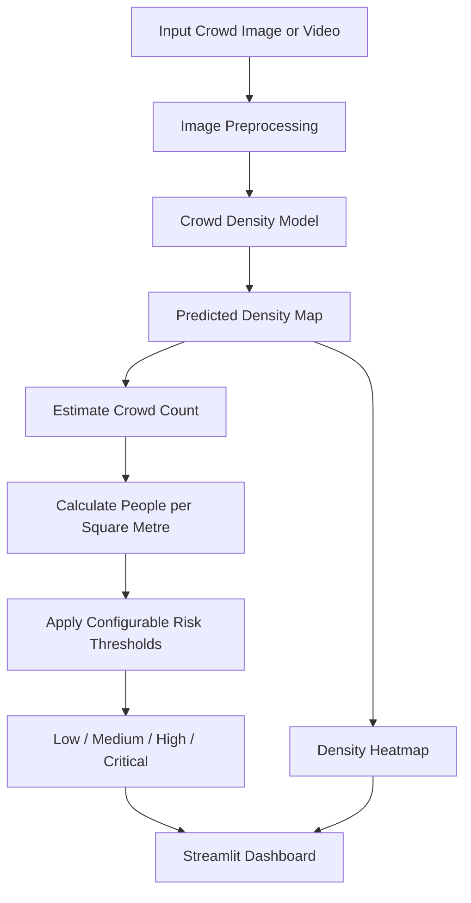

# सिंहस्थ सुरक्षा | Simhastha Suraksha

### AI-Powered Crowd Density Estimation & Risk Alert System for Nashik Simhastha Kumbh Mela

> **सिंहस्थ सुरक्षा — गर्दीवर एआयची नजर.**
>
> An AI-driven approach to crowd monitoring, density estimation, and risk awareness for large public gatherings.

<p align="center">
  
  
  
  
</p>

---

## Overview

Large religious gatherings such as the Nashik Simhastha Kumbh Mela can create challenging crowd-management conditions at ghats, roads, and other high-footfall areas.

**Simhastha Suraksha** is a deep learning micro-project designed to estimate crowd counts and density from images or video, visualize crowded regions, and assign configurable risk levels to monitored zones.

The goal is to demonstrate how computer vision can support crowd-monitoring decisions. The system is a prototype, not a replacement for trained personnel or official emergency-management systems.

## Key Features

- **Crowd Density Estimation** — Estimate the number of people in a crowd image.
- **Density Heatmaps** — Visualize regions with concentrated crowd activity.
- **Risk-Level Assessment** — Categorize monitored zones as Low, Medium, High, or Critical using configurable thresholds.
- **Interactive Dashboard** — Present predictions, zone summaries, and alert history.
- **Model Comparison** — Evaluate an MLP baseline, a custom CNN, and a CSRNet-style model.
- **Performance Evaluation** — Use Mean Absolute Error (MAE) and Root Mean Squared Error (RMSE).
- **Experiment Tracking** — Track training runs and model configurations.

## System Architecture



## Deep Learning Approach

| Stage | Model / Technique | Purpose |
|---|---|---|
| 1 | Multi-Layer Perceptron (MLP) | Baseline experimentation |
| 2 | Custom CNN | Learn visual features from crowd images |
| 3 | CSRNet-style model with VGG16 frontend | Estimate crowd-density maps |
| 4 | Threshold-based risk assessment | Convert estimated density into risk categories |

Transfer learning, data augmentation, regularization, and hyperparameter tuning will be explored during development.

## Technology Stack

| Category | Technologies |
|---|---|
| Language | Python 3.x |
| Deep Learning | PyTorch |
| Computer Vision | OpenCV, NumPy, SciPy |
| Models | MLP, Custom CNN, CSRNet-style architecture |
| Datasets | ShanghaiTech, UCF-QNRF |
| Visualization | Matplotlib, Plotly |
| Dashboard | Streamlit |
| Experiment Tracking | TensorBoard / Weights & Biases |
| Deployment | Docker, Hugging Face Spaces |

## Model Evaluation

Models will be evaluated on held-out data using MAE and RMSE. Numerical results will be added after the experiments are completed.

| Model | MAE ↓ | RMSE ↓ | Status |
|---|---:|---:|---|
| MLP Baseline | — | — | Pending evaluation |
| Custom CNN | — | — | Pending evaluation |
| CSRNet-style Model | — | — | Pending evaluation |

*Lower MAE and RMSE indicate better count-estimation performance. Comparisons should use consistent evaluation data and protocols.*

## Risk Assessment

The prototype will map estimated crowd density to configurable risk categories.

| Risk Level | Interpretation |
|---|---|
| Low | Density below the configured warning threshold |
| Medium | Increased crowd concentration |
| High | Elevated crowd-management concern |
| Critical | Density exceeds the configured critical threshold |

> **Safety note:** These categories are prototype outputs, not validated predictions of stampedes or emergencies. Thresholds require domain-specific validation before real-world use.

## Datasets

- [ShanghaiTech Crowd Counting Dataset](https://github.com/desenzhou/ShanghaiTechDataset)
- [UCF-QNRF Dataset](https://www.crcv.ucf.edu/data/ucf-qnrf/)

Public datasets may differ substantially from actual Simhastha footage in camera angle, lighting, crowd composition, and scene conditions. Performance on real Kumbh Mela footage must be evaluated separately.

## Getting Started

### 1. Clone the repository

```bash
git clone https://github.com/sanket1035/simhastha-suraksha.git
cd simhastha-suraksha
```

### 2. Create a virtual environment

```bash
python -m venv .venv
```

Activate it:

**Windows**
```bash
.venv\Scripts\activate
```

**Linux / macOS**
```bash
source .venv/bin/activate
```

### 3. Install dependencies

```bash
pip install -r requirements.txt
```

### 4. Launch the dashboard

```bash
streamlit run app/app.py
```

> These commands assume the corresponding files and application entry point have been implemented in the repository.

## Project Structure

```text
simhastha-suraksha/
├── app/
│   └── app.py
├── data/
├── models/
├── notebooks/
├── src/
│   ├── preprocessing/
│   ├── training/
│   ├── evaluation/
│   └── risk_assessment/
├── tests/
├── requirements.txt
├── Dockerfile
├── .gitignore
├── LICENSE
└── README.md
```

*Planned structure. Update it to match the actual repository as development progresses.*

## Limitations

- The model is not yet validated on representative Simhastha crowd footage.
- Density estimates may be inaccurate under severe occlusion or unusual camera angles.
- Dataset bias and domain shift may reduce real-world performance.
- Density-based thresholds alone cannot reliably predict crowd disasters.
- This prototype must not be used as the sole basis for public-safety decisions.

## Team

| Member | Responsibility |
|--------|----------------|
| Atharva | Dataset preparation, baseline models, regularization and activation experiments, hyperparameter sweeps |
| Sanket | CSRNet implementation and training, model export |
| Purva | Risk-assessment logic, evaluation, failure analysis, project report |
| Rahil | Dashboard, Docker deployment, README, demo video |


## Project Status

**Current stage:** In development.

- [ ] Dataset preparation and preprocessing
- [ ] MLP baseline
- [ ] Custom CNN
- [ ] CSRNet-style density estimation
- [ ] Risk-assessment module
- [ ] Dashboard integration
- [ ] Quantitative evaluation
- [ ] Demo video and deployment

## Acknowledgements

We acknowledge the researchers and dataset creators behind ShanghaiTech and UCF-QNRF, as well as the research community working on crowd counting and density estimation.

## License

This project is intended to be released under the MIT License. See [`LICENSE`](LICENSE) for details once the license file is added.

---

<p align="center">
  <b>Built to explore how deep learning can support safer, better-informed crowd management.</b>
  <br>
  सिंहस्थ सुरक्षा | Nashik, Maharashtra, India
</p>
